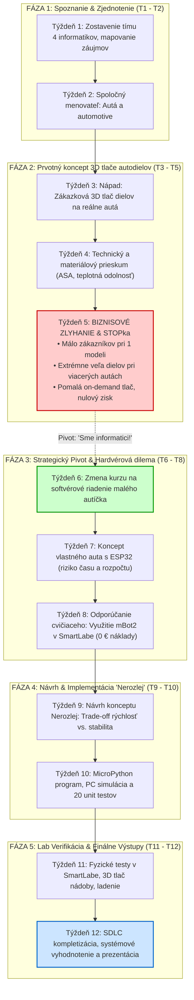
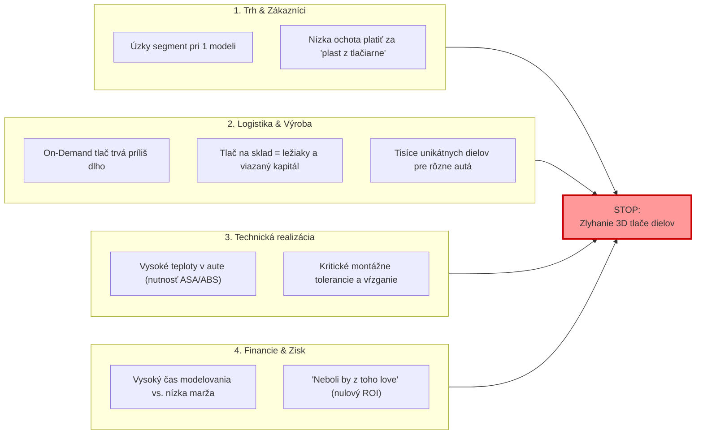

# 12-týždňová Roadmapa a Cesta projektu AutoLab (Nerozlej)

> **Typ dokumentu:** Výstupný projektový dokument a podklad k finálnej prezentácii  
> **Predmet:** Systémové myslenie v IT a digitálna fabrikácia (SMVIT / STHDF), FIIT STU  
> **Tím:** PRJ-069 (Branislav Bučko, Erik Dusík, Adrián Fáber, Samuel Roháč)  
> **Vetva:** `timeline`  
> **Kľúčové motto predmetu:** *„The goal is the journey“* – 75 % hodnotenia tvorí priebežná práca, systematické rozhodovanie a schopnosť poučiť sa zo slepých uličiek.

---

## Manažérske zhrnutie (Executive Summary)

Tento dokument detailne zachytáva **12-týždňovú cestu nášho tímu** od úvodného formovania až po funkčný autonómny systém **Nerozlej** postavený na platforme **mBot2**. 

Projekt prešiel zásadným strategickým **pivotom v 5. a 6. týždni**:
1. **Pôvodný zámer:** Zákazková 3D tlač náhradných a doplnkových dielov pre reálne automobily.
2. **Identifikované zlyhanie:** Biznisová a logistická neudržateľnosť (úzky trh pri jednom modeli vs. extrémna variabilita dielov pri viacerých modeloch, neúnosná dĺžka on-demand tlače, vysoké náklady a nulová rentabilita – *„neboli by z toho love“*).
3. **Strategické precitnutie:** Uvedomenie si tímovej identity – **všetci sme informatici (FIIT STU)**. Našou pridanou hodnotou nie je mechanická kusová výroba plastov, ale softvérové riadenie, algoritmy, systémová dynamika a telemetria.
4. **Výsledné riešenie:** Softvérovo riadené autonómne vozidlo riešiace komplexný optimalizačný problém (balansovanie rýchlosti prepravy a dynamickej stability nákladu) s podporou digitálnej fabrikácie v laboratóriu SmartLab.

---

## Vizuálna roadmapa projektu (12 týždňov)



---

## Podrobný priebeh týždeň po týždni (1 – 12)

### Týždeň 1: Formovanie tímu a mapovanie kompetencií
- **Cieľ:** Vytvorenie tímu, spoznanie osobných profilov, predstavenie individuálnych záujmov a zručností.
- **Priebeh:** Zoznámili sa štyria študenti FIIT STU: Branislav Bučko, Erik Dusík, Adrián Fáber a Samuel Roháč. Každý člen predstavil svoje doterajšie skúsenosti z programovania, obľúbené technológie a očakávania od predmetu SMVIT.
- **Zistenie:** Všetci členovia majú silné softvérové zázemie (Java, C, Python, web), no relatívne obmedzené skúsenosti so strojným inžinierstvom a pokročilým CAD navrhovaním zložitých mechanických zostáv.

### Týždeň 2: Hľadanie spoločného prieniku – Automotive vášeň
- **Cieľ:** Zjednotiť tím na jednej nosnej doméne projektu.
- **Priebeh:** Počas diskusie o voľnočasových záujmoch sa rýchlo ukázalo, že všetkých štyroch spája **veľká vášeň pre autá, motorizmus a techniku**.
- **Rozhodnutie:** Projekt bude bezpodmienečne zasadený do automobilového kontextu. Autá budú centrálnym motívom našej semestrálnej práce.

### Týždeň 3: Pôvodný nápad – Zákazková 3D tlač dielov na autá
- **Cieľ:** Spojiť automobilovú tému s požiadavkou predmetu na digitálnu fabrikáciu (3D tlač).
- **Koncept:** Založiť projekt na výrobe náhradných a tuningových plastových dielov pre automobily (napr. zlomené úchyty v interiéri, krytky zrkadiel, držiaky nápojov, špecifické redukcie, mriežky vetrania).
- **Predpoklad:** Na trhu chýbajú náhradné diely pre staršie autá, respektíve originálne OEM diely sú neúmerne drahé. Digitálna fabrikácia mala priniesť lacnú a flexibilnú alternatívu.

### Týždeň 4: Technický prieskum a počiatočné modelovanie
- **Cieľ:** Overiť materiálové a technologické požiadavky pre diely do áut.
- **Zistenia:**
  - Bežný materiál PLA je nepoužiteľný (interiér auta na slnku dosahuje 70–80 °C, kedy PLA mäkne a deformuje sa).
  - Nutnosť tlačiť z náročnejších materiálov ako PETG, ASA, ABS alebo Nylon (vyžadujú uzavretú komoru, vysoké teploty podložky a trysky, nebezpečné výpary).
  - Extrémna náročnosť na presné tolerancie – plastový diel musí v aute presne zapadnúť do existujúcich kovových či plastových západiek bez vôle a vŕzgania.

### Týždeň 5: Hĺbková biznisová a logistická analýza – Bod zlyhania
- **Cieľ:** Posúdiť ekonomickú životaschopnosť a škálovateľnosť biznis modelu.
- **Dôkladná analýza odhalila tri zásadné bariéry, ktoré projekt pochovali:**
  1. **Dilema veľkosti trhu vs. šírky portfólia:**
     - Ak by sme tlačili diely len na **jedno konkrétne auto** (napr. Škoda Octavia 1), cieľová skupina v našom dosahu je miniatúrna. Získali by sme jednotky zákazníkov, čo nepokryje ani čas investovaný do reverzného inžinierstva.
     - Ak by sme chceli **pokryť viacero modelov a značiek**, počet unikátnych dielov rastie do tisícov. Každý model vyžaduje vlastné 3D skenovanie, CAD modelovanie, testovacie prototypy a ladenie tolerancií.
  2. **Logistická slepá ulička a neudržateľná On-Demand výroba:**
     - Výroba na sklad je vylúčená (stovky rôznych dielov viažucich materiál bez istoty predaja).
     - Model „tlač až po objednávke“ (On-Demand) trvá neprimerane dlho: kým zákazník dostane diel (namodelovanie, tlač trvajúca 8–15 hodín, post-processing, doručenie poštou), uplynie týždeň. Zákazník očakáva rýchle doručenie a nechce čakať na drobnú plastovú sponu.
  3. **Ekonomická bilancia („Neboli by z toho love“):**
     - Pomer vloženej práce (meranie, modelovanie, nepodarené výtlačky, spotreba elektriny a drahého ASA filamentu) voči sume, ktorú je bežný motorista ochotný zaplatiť za plastovú náhradu, bol hlboko stratový.
     - Riziko zodpovednosti za škodu: ak sa diel v aute zlomí a spôsobí poškodenie či nehodu, hrozí právna zodpovednosť.
- **Rozhodnutie tímu:** **Projekt v tejto forme okamžite zastaviť.** Pokračovať by znamenalo plytvanie časom na neživotaschopný produkt.

---

### Analýza príčin zlyhania pôvodného konceptu (Ishikawa diagram)



---

### Týždeň 6: Strategický Pivot – „Sme informatici, riešme softvér!“
- **Cieľ:** Predefinovať identitu tímu a pretransformovať automobilovú vášeň do informatického projektu.
- **Kľúčové uvedomenie:** Našou konkurenčnou výhodou nie je mechanická výroba, ale **vývoj softvéru, riadenie v reálnom čase, senzorické systémy a algoritmy**.
- **Nový koncept:** Malé autonómne/robotické autíčko (**AutoLab**).
- **Úloha digitálnej fabrikácie:** 3D tlač nezmizne, ale zmení svoju rolu – nebude primárnym predajným artiklom, ale funkčnou podporou nášho hardvéru (špeciálne nadstavby, držiaky, funkčné prvky).

### Týždeň 7: Vývoj vlastného hardvéru (ESP32) vs. Časový tlak
- **Cieľ:** Navrhnúť elektroniku a softvér pre vlastné robotické vozidlo.
- **Priebeh:** Vypracovali sme návrh zadania s riadiacou doskou ESP32, motorovým budičom DRV8833 a ultrazvukovým senzorom. Erik Dusík pripravil prototyp webového rozhrania a firmvéru.
- **Riziká:** Do konca semestra ostávalo len pár týždňov. Objednávanie komponentov, spájkovanie, riešenie napájania z batérií a odlaďovanie hardvérových chýb hrozilo vyčerpaním celého času bez dosiahnutia stabilného softvérového výsledku.

### Týždeň 8: Odporúčanie cvičiaceho a prechod na mBot2
- **Cieľ:** Eliminovať hardvérové riziko a zamerať sa čisto na systémové a softvérové ciele.
- **Zlomový moment:** Konzultácia s cvičiacim v labe. Cvičiaci odporučil využiť pripravenú laboratórnu flotilu robotov **Makeblock mBot2 (CyberPi)** v SmartLabe FIIT STU.
- **Dopad rozhodnutia:**
  - Finančné náklady klesli na **0 €** (žiadne vyhadzovanie vlastných peňazí za komponenty).
  - Získali sme špičkovo vybavenú platformu: enkóderové motory, displej CyberPi, gyroskop, Quad RGB senzor čiary, ultrazvukový senzor.
  - Tím sa mohol plne sústrediť na to podstatné: **kvalitný kód v MicroPythone a systémové myslenie**.

### Týždeň 9: Definícia konceptu „Nerozlej“ (The Spill-Proof Courier)
- **Cieľ:** Vytvoriť atraktívny scenár s reálnou dynamickou spätnou väzbou.
- **Koncept Nerozlej:** Robotické autíčko funguje ako autonómny kuriér/čašník, ktorý vezie náklad (loptičku v špeciálnej 3D tlačenej miske) po vytýčenej dráhe do cieľa.
- **Systémová dilema:**
  - Hráč alebo algoritmus optimalizuje čas jazdy.
  - Príliš pomalá jazda = bezpečná, ale neefektívna (veľký čas doručenia).
  - Príliš rýchla jazda, prudký rozjazd či agresívne rezanie zákrut = loptička vyletí z nádoby (rozliatie nákladu, diskvalifikácia).
  - Vzniká učebnicový príklad **Causal Loop Diagramu** so spätnými väzbami medzi rýchlosťou, odstredivou silou a stabilitou.

---

### Systémové myslenie konceptu Nerozlej (Causal Loop Diagram)

```mermaid
flowchart TD
    Rychlost["(+) Rýchlosť jazdy"] -->|Znižuje (-)| Cas["(-) Čas doručenia (Efektivita)"]
    Rychlost -->|Zvyšuje (+)| Zrýchlenie["(+) Zotrvačné & Odstredivé sily"]
    Zrýchlenie -->|Znižuje (-)| Stabilita["(-) Stabilita loptičky v nádobe"]
    Stabilita -->|Pri prekročení limitu| Pad["(X) Pád loptičky / Rozliatie"]
    Pad -->|Vynucuje (-)| Penalizacia["(+) Neúspech misie / Reset"]
    
    style Pad fill:#ff9999,stroke:#cc0000,stroke-width:2px;
    style Cas fill:#ccffcc,stroke:#009900,stroke-width:2px;
    style Rychlost fill:#cce5ff,stroke:#0066cc,stroke-width:2px;
```

---

### Týždeň 10: Implementácia v MicroPythone a testovanie na PC
- **Cieľ:** Napísať spoľahlivý, čistý riadiaci kód bez závislosti na fyzickej prítomnosti v labe.
- **Výsledky:**
  - Kód pre CyberPi napísaný v jazyku MicroPython (`nerozlej.py`).
  - Vytvorenie mockov a simulátora hardvéru CyberPi na PC.
  - Vytvorenie sady **20 automatizovaných unit testov** pokrývajúcich ohraničenie parametrov, stavový automat jazdy a bezpečnostné poistky (núdzové zastavenie, strata čiary, ultrazvuková detekcia prekážky).
  - Žiadne blokové programovanie (mBlock) – čistý verzovaný kód v Gite.

### Týždeň 11: Fyzická verifikácia v SmartLabe a 3D tlač
- **Cieľ:** Ostré overenie na fyzickom robote a dodanie prvku digitálnej fabrikácie.
- **Priebeh:**
  - Návšteva SmartLabu, nahratie programu do reálneho robota mBot2.
  - Návrh a vytlačenie 3D držiaka a nádobky na mieru priamo v laboratóriu FIIT STU (náklady v centoch).
  - Overenie akceptačných testov N1–N6: kalibrácia Quad RGB senzora, reakcia na čiernu pásku, dynamické brzdenie pred prekážkou.
  - Zber reálnych telemetrických dát (jazda s loptičkou pri rôznych profiloch zrýchlenia).

### Týždeň 12: Kompletizácia SDLC, systémová syntéza a prezentácia
- **Cieľ:** Skompletizovať projektovú dokumentáciu, zhodnotiť dosiahnuté výsledky a pripraviť finálnu prezentáciu.
- **Výstupy:**
  - Uzavretá dokumentácia všetkých fáz SDLC (Business, Top Level Architecture, Solution Architecture, Analysis, Design, Implementation, Testing, Operation, Change Management).
  - Dôkladne zdokumentovaná cesta projektu potvrdzujúca princíp *„The goal is the journey“*.
  - Pripravené podklady na finálnu prezentáciu (10–12 min) a osobný pitch každého člena tímu.

---

## Prehľadná tabuľka 12-týždňovej roadmapy

| Týždeň | Fáza projektu | Kľúčová aktivita | Výsledok / Míľnik | Stav |
|:---:|:---|:---|:---|:---:|
| **T1** | Team Building | Zoznámenie tímu, mapovanie schopností 4 informatikov | Zostavený tím, zmapované IT zázemie | Dokončené |
| **T2** | Brainstorming | Hľadanie témy, identifikácia spoločného záujmu | Zjednotenie na téme: Autá a automotive | Dokončené |
| **T3** | Koncept 1.0 | Nápad zákazkovej 3D tlače náhradných dielov na autá | Definovaný prvotný zámer digitálnej fabrikácie | Dokončené |
| **T4** | R&D Prieskum | Testovanie materiálov (ASA, PETG), teplotná odolnosť | Zistená vysoká technologická a montážna náročnosť | Dokončené |
| **T5** | **Bod Zlyhania** | **Biznisová a logistická analýza 3D tlače dielov** | **Zistenie neudržateľnosti: úzky trh, pomalá on-demand tlač, nulový zisk. Koncept STOP!** | **Dokončené (Pivot)** |
| **T6** | **Pivot 1.0** | **Reflexia identity: 'Sme informatici, nie mechanici'** | **Prechod na softvérové riadenie malého autíčka (AutoLab)** | Dokončené |
| **T7** | Koncept 2.0 | Návrh vlastného auta s ESP32, driverom a senzormi | Riziko rozpočtu a nestíhania termínov do konca semestra | Dokončené |
| **T8** | **Optimalizácia** | Konzultácia s cvičiacim, ponuka laboratórnych mBot2 | Rozhodnutie: 0 € rozpočet, využitie mBot2 v SmartLabe | Dokončené |
| **T9** | Koncept 3.0 | Definícia scenára „Nerozlej“ (kuriér s loptičkou) | Modelovanie trade-offu: rýchlosť vs. rozliatie | Dokončené |
| **T10** | Implementácia | MicroPython kód pre CyberPi, PC simulácia | 20 unit testov prešlo, hotová logika riadenia | Dokončené |
| **T11** | Verifikácia | Testovanie na mBot2 v SmartLabe, 3D tlač nádoby | Úspešné fyzické jazdy, overené akceptačné testy N1–N6 | Dokončené |
| **T12** | Finále | SDLC syntéza, systémové vyhodnotenie, prezentácia | Pripravené výstupy, tímová obhajoba a prezentácia | Pripravené |

---

## Scenár finálnej prezentácie (Storytelling pre obhajobu)

Táto štruktúra je navrhnutá pre 10–12 minútovú finálnu prezentáciu, pričom priamo stavia na príbehu zlyhania a úspešného pivotu:

### Slajd 1: Titulný slajd & Tím
- **Názov:** AutoLab – Od slepej uličky 3D tlače k autonómnemu kuriérovi „Nerozlej“
- **Tím:** PRJ-069 (Branislav Bučko, Erik Dusík, Adrián Fáber, Samuel Roháč)
- **Podtitul:** Systémové myslenie v IT a digitálna fabrikácia, FIIT STU

### Slajd 2: Ako to celé začalo – Autá ako spoločná vášeň (T1 – T2)
- Štyria študenti informatiky s láskou k motorizmu.
- Jasná dohoda: Náš projekt musí mať kolesá a motor.
- Hľadanie spôsobu, ako do automobilizmu zapojiť 3D tlač.

### Slajd 3: Prvý nápad: Zákazková 3D tlač autodielov (T3 – T4)
- Hypogéza: Autodiely sú drahé alebo nedostupné, vytlačíme ich na 3D tlačiarni lacnejšie.
- Testovanie materiálov: PLA zlyháva na slnku, nutnosť náročného ASA/ABS.
- Prvé merania a CAD modely.

### Slajd 4: Prečo sme zlyhali: Krutá biznisová a logistická realita (T5)
- **Dilema trhu:** Jedno auto = žiadni zákazníci; Všetky autá = nekonečné množstvo dielov.
- **Logistika:** Nemôžeme tlačiť na sklad (ležiaky); On-Demand tlač trvá pridlho (zákazník odchádza).
- **Financie:** Obrovský čas na modelovanie, drahý materiál, riziko nepodarkov -> *„Neboli by z toho žiadne love.“*

### Slajd 5: Zlomový moment: „Veď my sme predsa informatici!“ (T6)
- Prehodnotenie tímových silných stránok. Naša hodnota je v algoritmoch, logike a riadení.
- **Pivot:** Presun od pasívneho kusu plastu k inteligentnému autonómnemu vozidlu.
- 3D tlač sa stáva podporným nástrojom funkčnej nadstavby, nie jadrom biznisu.

### Slajd 6: Cesta cez prekážky: Od ESP32 k mBot2 v SmartLabe (T7 – T8)
- Pôvodný plán vlastného auta (ESP32) narážal na drahé diely a riziko nestihnutia semestra.
- Skvelá rada od cvičiaceho: Využite roboty mBot2 v SmartLabe FIIT STU!
- Výsledok: Nulový finančný rozpočet (0 €), okamžitý štart a čisté zameranie na softvér.

### Slajd 7: Finálne riešenie: Projekt „Nerozlej“ (T9)
- Autonómny robot-čašník vezie loptičku v 3D tlačenej nádobe.
- Hráč a algoritmus hľadajú kompromis: Ako ísť čo najrýchlejšie, ale nerozliať náklad?
- Ukážka systémového myslenia: Balansovanie spätnej väzby (rýchlosť vs. odstredivá sila).

### Slajd 8: Softvérová architektúra a simulácia na PC (T10)
- Kód v čistom MicroPythone pre procesor CyberPi.
- Vývoj bez hardvéru: Vlastný mock CyberPi a 20 automatizovaných unit testov na PC.
- Robustná bezpečnostná logika: okamžitý stop tlačidlom B, ochrana pred zrážkou a stratou čiary.

### Slajd 9: Digitálna fabrikácia & Fyzické testy v SmartLabe (T11)
- Návrh a 3D tlač ergonomickej nádobky a držiaka priamo v SmartLabe.
- Ostré jazdy po čiernej vodiacej línii s ultrazvukovou brzdou pred prekážkou.
- Overenie akceptačných kritérií N1–N6 na reálnych podmienkach.

### Slajd 10: Vyhodnotenie a lekcie z projektu (T12)
- **The goal is the journey:** Skutočnou hodnotou projektu nebolo len finálne autíčko, ale proces iterácií a odvaha zahodiť slepú uličku.
- Rýchle zlyhanie (Fail fast): Lepšie pochopiť biznisovú nerealizovateľnosť v 5. týždni než prezentovať polotovar na konci.
- Zladenie riešenia s kompetenciami tímu: Stavajte na tom, v čom ste doma (informatika).

---

## Záver a prepojenie s dokumentáciou

Tento dokument je integrálnou súčasťou projektovej dokumentácie SDLC v repozitári PRJ-069-AutoLab:
- Prepája fázu **01 Business** (analýza neudržateľnosti 3D tlače dielov) s fázou **09 Change Management** (odôvodnenie všetkých pivotov).
- Poskytuje podklad pre [podklady k prezentácii](prezentacia.md) a denníky aktivít v osobných repozitároch členov tímu.
- Zaznamenáva kompletnú genézu projektu v súlade s požiadavkami predmetu SMVIT / STHDF na FIIT STU.

