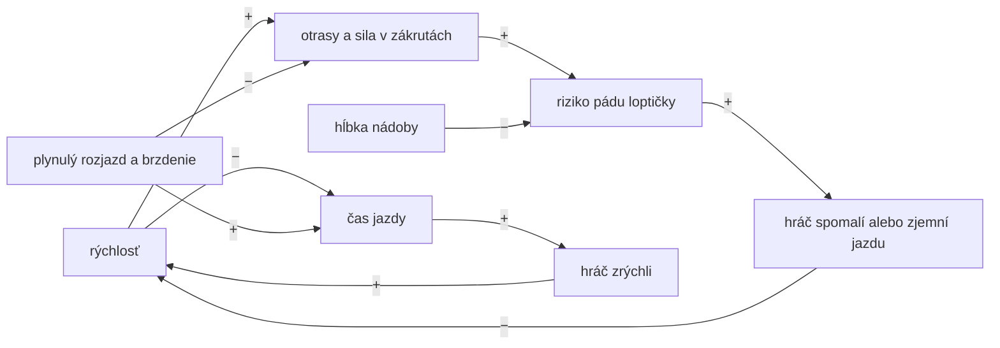

# Možnosť projektu: Nerozlej

> **Stav:** pracovný výber od 16. 11. 2026. Tím ho formálne nepotvrdil, ale pre posun projektu podľa neho pracujeme a cvičiaci proti tomu nič nemá. Program pre auto je v [mbot2/](../mbot2/), na aute sa zatiaľ nespúšťal. [Špecifikácia](specifikacia.md) a [testovací protokol](testovaci-protokol.md) platia pre pôvodnú verziu s ESP32, pre Nerozlej platí tento dokument.

## Myšlienka

Robot mBot2 ide po čiare ako čašník a v 3D tlačenej nádobe vezie loptičku. Hráč nastaví, ako auto jazdí: rýchlosť, rozjazd, brzdenie a zatáčanie. Auto s týmto nastavením odjazdí trasu až k „stolu“ (prekážke na konci) a cieľom je dôjsť čo najrýchlejšie bez straty loptičky.

Rýchlejšia jazda skracuje čas, ale zvyšuje riziko pádu. Hráč preto hľadá najlepší kompromis, a práve na tom je vidieť systémové myslenie.

Autá si požičiavame v SmartLabe, kde je ich približne 20. Domov si ich nepožičiame, preto program skúšame pri občasných návštevách laboratória.

## Cieľová skupina a prínos

Toto je pracovná hypotéza, zatiaľ nie je overená so žiadnym učiteľom ani žiakom.

| Kto | Prínos |
|---|---|
| **Učiteľ**, ktorý už má mBoty | hotová aktivita na hodinu bez nákupu nových robotov |
| **Stredoškoláci** | skúšajú si kompromis medzi rýchlosťou a plynulosťou na vlastných pokusoch, nemusia programovať |

## Systémový pohľad

Diagram príčinných väzieb ukazuje, prečo hra nemá jedno „správne“ nastavenie. Znamienko + znamená, že keď rastie príčina, rastie aj následok; znamienko − znamená opak.

Sú tu dve vyrovnávajúce slučky: dlhý čas ťahá hráča k vyššej rýchlosti a pády loptičky ho zas spomaľujú. Skóre z času a otrasov hráčovi ukazuje, kde je medzi nimi rovnováha.

## Rozsah

### Must

| Oblasť | Čo treba |
|---|---|
| Jazda | sledovanie čiary, plynulý rozjazd a brzdenie, zastavenie pri cieli |
| Nastavenia | rýchlosť, rozjazd, brzdná dráha a zatáčanie; nastavujú sa priamo na aute joystickom a displejom |
| Skóre | čas, otrasy z akcelerometra a to, či loptička ostala v nádobe |
| 3D tlač | jedna nádoba s držiakom, ktorá nezakrýva displej, joystick ani senzory |
| Bezpečnosť | po zapnutí auto stojí, zastaví pred prekážkou, pri strate čiary a tlačidlom B; v nádobe žiadna voda |
| Pre učiteľa | krátky návod a pracovný list |

Obtiažnosť dávajú nastavenia a trasa, nie viac nádob. Ak bude nádoba po prvej tlači zlá, opravíme ju a obe verzie odfotíme.

### Should

- ľahšia a ťažšia trasa (rovná čiara a čiara so zákrutou)
- zoznam posledných jázd a rekord na displeji (už je v programe)

### Mimo rozsahu

Aplikácia v mobile, viac hĺbok nádoby a automatické spomalenie podľa otrasov. Môžu prísť na rad, až keď bude hotové všetko vyššie.

### Čo auto nevie

- **Nevidí pohyb loptičky.** Akcelerometer meria otrasy auta, nie loptičky.
- **Pád loptičky zadá hráč** tlačidlom po jazde.
- **Nastavenie platí pre celú jazdu.** Dobré nastavenie hľadá hráč.

## Program na aute

Program je [mbot2/nerozlej.py](../mbot2/nerozlej.py), v MicroPythone pre CyberPi. Ako ho nahrať, je v [mbot2/README.md](../mbot2/README.md).

### Nastavenia

Rozsahy sú začiatočné a doladia sa po prvých jazdách. Program každú hodnotu pred jazdou obmedzí na povolený rozsah.

| Parameter | Čo znamená | Rozsah | Krok | Predvolené |
|---|---|---|---|---|
| Rýchlosť | najvyšší výkon motorov | 20 až 80 % | 5 | 40 % |
| Rozjazd | za koľko sekúnd auto dosiahne nastavenú rýchlosť | 0 až 3 s | 0,5 | 1 s |
| Brzdenie | na akej dráhe pred cieľom auto plynulo spomaľuje | 0 až 40 cm | 5 | 20 cm |
| Zatáčanie | ako silno auto opravuje smer na čiare | 1 až 10 | 1 | 4 |
| Trasa | Ciara (sleduje čiaru) alebo Rovno (bez čiary, napr. keď senzor čiary nefunguje) | | | Ciara |

### Jazda

1. Hráč nastaví parametre v menu a stlačí A.
2. Odpočet 3 s. Auto stojí a meria zrýchlenie v pokoji, voči ktorému sa potom počítajú otrasy.
3. Auto sa rozbieha podľa parametra Rozjazd. Na čiare ho riadi P regulátor podľa odchýlky zo senzora čiary.
4. Keď je prekážka bližšie ako `STOP_CM` + Brzdenie, výkon klesá úmerne vzdialenosti. Pri `STOP_CM` (8 cm) auto zastaví. To je cieľ aj bezpečnostné zastavenie.
5. Auto zastaví aj vtedy, keď 0,5 s nevidí čiaru, keď hráč stlačí B alebo po 60 s.
6. Hráč zadá, či loptička ostala v nádobe. Displej ukáže čas, priemerné otrasy, špičku otrasov, dôvod zastavenia a rekord.

Jazda je úspešná, keď auto zastavilo v cieli a loptička ostala v nádobe. Rekord je najkratší čas úspešnej jazdy.

### Akceptačné testy

| # | Test | Splnené, ak |
|---|---|---|
| N1 | zastavenie pred stenou pri predvolenom nastavení | bez dotyku v 5 z 5 pokusov |
| N2 | jazda po čiare so zákrutou | auto dôjde do cieľa v 4 z 5 pokusov |
| N3 | zmena parametrov | zmena sa prejaví pri ďalšej jazde: pomalší rozjazd je vidieť a dlhšie brzdenie zastaví plynulejšie |
| N4 | kompromis | pri predvolenom nastavení loptička ostane v nádobe, pri rýchlosti 80 % bez rozjazdu a brzdenia spadne aspoň raz z 3 |
| N5 | bezpečnosť | auto po zapnutí stojí, zastaví tlačidlom B aj po zdvihnutí z čiary |
| N6 | návod | človek mimo tímu podľa návodu spustí jazdu bez našej pomoci |

## Voliteľné doplnky

Pridáme ich, iba ak bude hotové všetko z Must a ostane čas. Sú zoradené od najmenšej práce.

| Doplnok | Práca | Čo prinesie |
|---|---|---|
| živé demo na prezentácii: auto si vyskúša cvičiaci alebo publikum | žiadna | demo sa ukáže samo a zapamätá sa |
| diagram príčinných väzieb (vyššie) prekresliť do EA | asi 30 min | systémový pohľad aj v triednom modeli |
| tabuľka kompromisu: 3 rýchlosti × 3 jazdy, zapísať čas a či loptička spadla | asi 30 min v labe | podklad pre fázu Testing a jeden graf do prezentácie |
| krátke video jazdy | asi 15 min | podklad pre prezentáciu a stránku projektu |

**LemonTree** sa v predmete používa na zlúčenie zmien v triednom EA modeli. Podľa toho, čo si pamätáme z cvičenia, nie je potrebný, a kým nebudeme meniť spoločný model naraz viacerí, nič nám neprinesie. Preto ho nepridávame.

## Riziká

| Riziko | Čo s tým |
|---|---|
| program sa na aute správa inak než v simulácii | test senzorov v programe a [ťahák do labu](../mbot2/tahak-lab.md) |
| do labu chodíme len občas | každú návštevu pripraviť vopred, konštanty na ladenie sú na začiatku programu |
| sledovanie čiary nie je dosť presné | jednoduchá trasa, v najhoršom prípade Trasa Rovno |
| vibrácie motorov prekryjú otrasy z jazdy | skóre len z času a pádu loptičky |
| nádoba zmení ťažisko alebo zakryje ovládanie | najprv kartónový model, potom tlač |

## Porovnanie možností

| | AutoLab s ESP32 | Brzdná výzva | Nerozlej |
|---|---|---|---|
| **Auto** | vlastné, treba kúpiť diely | požičaný mBot2 | požičaný mBot2 |
| **3D tlač** | celý podvozok | nárazník a zadná doska | nádoba a držiak |
| **Ovládanie** | mobil cez stránku v aute | displej a joystick na aute | displej a joystick na aute |
| **Stav softvéru** | napísaný, na hardvéri neoverený | nezačatý | napísaný, na hardvéri neoverený |
| **Hlavné riziko** | nákup, zapojenie a zloženie áut | spoľahlivosť zastavenia | presnosť čiary a dáta z akcelerometra |
| **Stav** | odložené | odložené | pracovný výber |

## Otvorené otázky

1. Súhlasí cvičiaci, že 3D tlač bude len nádoba a držiak?
2. Ako si po dokončení rozdelíme role a témy KNIFE?

Zdroj k režimom Live a Upload: [Makeblock Education](https://education.makeblock.com/?p=78174).
