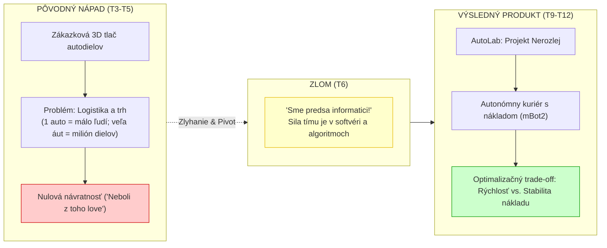

# Podklady k finálnej prezentácii

> **Typ:** Výstupný dokument k obhajobe a štruktúra prezentácie  
> **Predmet:** Systémové myslenie v IT a digitálna fabrikácia (SMVIT / STHDF), FIIT STU  
> **Tím:** PRJ-069 AutoLab (Branislav Bučko ST021, Erik Dusík ST022, Adrián Fáber ST023, Samuel Roháč ST032)  
> **Dĺžka prezentácie:** 10–12 minút + Q&A diskusia  
> **Podrobný týždenný príbeh:** Pozri [12-týždňová Roadmapa a Cesta projektu](cesta-a-roadmapa-12-tyzdnov.md)

---

## 1. Biznisový obrázok a príbeh projektu

Projekt prešiel radikálnym pivotom – od slepej uličky zákazkovej 3D tlače autodielov k autonómnemu softvérovému systému.

- **Používateľ / Cieľová skupina:** Výučbové laboratóriá, študenti a operátori intralogistických autonómnych systémov (AGV – Automated Guided Vehicles).
- **Riešený problém:** Ako v autonómnej logistike prepraviť krehký/tekutý náklad čo najrýchlejšie bez jeho poškodenia, rozliatia či havárie pri dynamických zmenách smeru a prekážkach.
- **Vytvorená hodnota:** 
  1. Softvérový riadiaci systém v MicroPythone s konfigurovateľnými jazdnými profilmi (rýchlosť, akcelerácia, brzdná dráha, citlivosť na čiaru).
  2. Nulové finančné náklady na hardvér (využitie laboratórnej flotily mBot2 CyberPi).
  3. Preukázanie princípov systémového myslenia (vyváženie spätnej väzby medzi časom a stabilitou).
  4. Digitálna fabrikácia na mieru navrhnutej 3D nádoby s mechanickým uchytením.

---

## 2. Kde sa nachádzame a vývoj zámeru

### Čo sme plánovali a čo sme dodali (Plán vs. Realita)

| Pôvodný plán | Realita a zmena | Prečo sa to líši (Lekcia z cesty) |
|---|---|---|
| **Zákazková 3D tlač dielov na reálne autá** (T3) | **Úplne zrušené v T5** | Neudržateľná logistika, obrovské množstvo unikátnych dielov, pomalá on-demand tlač a žiadni platiaci zákazníci (*„neboli by z toho love“*). |
| **Vlastné robotické auto z dielov s ESP32** (T7) | **Nahradené flotilou mBot2 v T8** | Stavba a nákup vlastného HW niesli vysoké riziko nestihnutia termínov a zbytočných osobných nákladov. Požičaný mBot2 stál 0 € a urýchlil vývoj. |
| **Zložité viacúrovňové nádoby a podnosy** (T9) | **Jedna optimalizovaná nádoba** | Zložitosť nepatrí do hardvéru, ale do softvéru. Náročnosť riadia softvérové parametre jazdy a geometria trasy. |
| **Programovanie v blokoch (mBlock)** | **Čistý MicroPython + PC testy** | Textový kód umožňuje verzovanie v Gite, automatizované unit testy a nezávislosť na laboratóriu. |

### Aktuálny stav implementácie
- **Čo funguje:**
  - Kompletný riadiaci program v MicroPythone (`nerozlej.py`) s bezpečnostným stavovým automatom.
  - Simulátor CyberPi a **20 automatizovaných unit testov** bežiacich na PC.
  - Okamžité zastavenie pred prekážkou (ultrazvuk) a núdzové zastavenie tlačidlom B.
  - Reakcia na vodiacu líniu cez Quad RGB senzor.
  - 3D model a vytlačená transportná nádobka na mieru pre mBot2 šasi.
- **Čo sme eliminovali (uprataný rozsah):**
  - Vyradené nefunkčné pokusy o ESP32 a nákupy drahých súčiastok (uložené v `archiv/`).
  - Vyradená zákazková mechanická výroba plastov pre reálne automobily.

---

## 3. Výstupy projektu podľa fáz SDLC

| Fáza SDLC | Kľúčový výstup tímu | Odkaz na dokumentáciu |
|---|---|---|
| **01 Business** | Analýza zlyhania 3D autodielov, biznis model autonómnej logistiky | [Roadmapa kap. T5](cesta-a-roadmapa-12-tyzdnov.md#týždeň-5-hĺbková-biznisová-a-logistická-analýza--bod-zlyhania), [Nerozlej](moznost-nerozlej.md#cieľová-skupina-a-prínos) |
| **02 Top Level Architecture** | Causal Loop Diagram: kompromis medzi rýchlosťou jazdy a zotrvačnými silami | [Systémový pohľad](moznost-nerozlej.md#systémový-pohľad) |
| **03 Solution Architecture** | Prepojenie CyberPi, enkóderových motorov, Quad RGB a ultrazvukového senzora | [Architektúra riešenia](moznost-nerozlej.md#architektúra-systému) |
| **04 Analysis** | Funkčné a bezpečnostné požiadavky, matica rizík | [Rozsah a riziká](moznost-nerozlej.md#rozsah) |
| **05 Design** | Parametrický model riadenia (akcelerácia, brzdenie, limity), 3D návrh nádoby | [Program na aute](moznost-nerozlej.md#program-na-aute) |
| **06 Implementation** | Zdrojový kód v MicroPythone, STL model pre digitálnu fabrikáciu | [mbot2/nerozlej.py](../mbot2/nerozlej.py) |
| **07 Testing & Verification** | PC unit testy (20/20 úspešných) + akceptačné testy v labe N1–N6 | [Akceptačné testy](moznost-nerozlej.md#akceptačné-testy) |
| **08 Operation** | Návod na obsluhu, bezpečnostný postup, ťahák do labu | [Ťahák do labu](../mbot2/tahak-lab.md) |
| **09 Change Management** | Záznam pivotov z 3D tlače dielov na ESP32 a finálne na mBot2 | [Cesta projektu](cesta-projektu.md), [Zmeny](README.md#zmeny-oproti-plánu) |

---

## 4. Štyri kľúčové momenty prezentácie (Storytelling pre porotu)

1. **Momenty 1 (T2): Spoločný menovateľ – Autá.**  
   Štyria študenti zistili, že ich spája silná vášeň pre autá. Stanovili sme si jasnú podmienku: projekt musí mať kolesá a pohon.
2. **Moment 2 (T5): Krach nápadu s 3D tlačou autodielov.**  
   Analýza ukázala, že tlačiť na jedno auto znamená žiadnych zákazníkov, a tlačiť na veľa áut znamená tisíce dielov, pomalú výrobu a žiadny profit (*„neboli by z toho love“*). Nápad sme nemilosrdne pochovali.
3. **Moment 3 (T6): Precitnutie – „Sme predsa informatici!“.**  
   Uvedomili sme si, že našou skutočnou silou je programovanie a riadenie, nie výroba plastových súčiastok. Pivotovali sme na inteligentné softvérové riadenie malého autíčka.
4. **Moment 4 (T8-T10): Od 0 € nákladov k 20 automatizovaným testom.**  
   Využitím robotov mBot2 zo SmartLabu sme ušetrili rozpočet a sústredili sa na kód v MicroPythone, ktorý sme simulačne otestovali na PC ešte pred vstupom do labu.

---

## 5. Individuálny prínos členov tímu

| Člen | Kľúčová zodpovednosť v projekte | KNIFE príspevok |
|---|---|---|
| **Branislav Bučko (ST021)** | Analýza požiadaviek, testovanie v labe, overenie fyzických jázd | *(podľa osobného repozitára)* |
| **Erik Dusík (ST022)** | Softvérová architektúra v MicroPythone, PC simulátor a unit testy, SDLC dokumentácia | [ST-022-ErikDusik](https://github.com/Hinzun/ST-022-ErikDusik) |
| **Adrián Fáber (ST023)** | Digitálna fabrikácia, 3D modelovanie nádoby na mieru, systémové väzby | *(podľa osobného repozitára)* |
| **Samuel Roháč (ST032)** | Telemetria, spracovanie nameraných časov jázd, príprava prezentácie a pitchu | *(podľa osobného repozitára)* |

---

## 6. Prezentácia – Rýchly prehľad slajdov (Slide Deck Cheat Sheet)

- **Slajd 1:** Titulka (AutoLab: Nerozlej – Autonómny kuriér s krehkým nákladom).
- **Slajd 2:** Tím a naša vášeň pre autá.
- **Slajd 3:** Prvý nápad: 3D tlač autodielov (nádej vs. realita).
- **Slajd 4:** Prečo to krachlo: Logistická a biznisová slepá ulička.
- **Slajd 5:** Pivot: Sme informatici – prechod na softvér a robotické vozidlo.
- **Slajd 6:** Hardvérová voľba: Prečo mBot2 v SmartLabe predbehol stavbu ESP32 (0 € rozpočet).
- **Slajd 7:** Projekt Nerozlej: Systémová dynamika, spätná väzba a hľadanie optimálnej rýchlosti.
- **Slajd 8:** Softvér v MicroPythone & 20 automatizovaných testov na PC.
- **Slajd 9:** Digitálna fabrikácia nádoby a ostré testy v SmartLabe.
- **Slajd 10:** Zhrnutie a lekcie: Prečo bola cesta dôležitejšia než pôvodný predpoklad.
