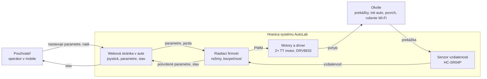

# AutoLab – technická špecifikácia

Ako AutoLab funguje: systémový pohľad, architektúra, firmvér, komunikácia, parametre a webová stránka.
Čo robíme a prečo (rozsah, požiadavky, akceptačné testy, hardvér, harmonogram, role) je v [návrhu zadania](navrh-zadania.md).

> Vychádza z AI konceptu kolegu (PDF, október 2026). Koncept sme posúdili ([návrh zadania, kap. 4](navrh-zadania.md#4-posúdenie-ai-špecifikácie)), opravili chyby a zúžili ho na dohodnutý rozsah. Platí táto verzia, PDF už nepoužívame.

## 1. Rozsah v skratke

- 2 autá, každé s vlastným ESP32 a vlastnou Wi-Fi sieťou.
- **Must:** jazda joystickom z mobilu (MANUAL), zmena parametrov za jazdy, zabrzdenie pred prekážkou (aj pred autom idúcim vpredu, bez komunikácie medzi autami), zastavenie pri strate spojenia.
- **Should:** sledovanie čiary (LINE), živé hodnoty na stránke. **Could:** uloženie parametrov do auta.
- Bez servera, databázy, mobilnej aplikácie a bez komunikácie medzi autami.

## 2. Systémový pohľad

Auto tvoria dve vnorené spätné väzby:

- **Vnútorná slučka** vo firmvéri beží 50× za sekundu bez človeka: zmeria vzdialenosť, rozhodne, nastaví motory.
- **Vonkajšia slučka** je človek na stránke: vidí, ako auto jazdí, a mení parametre (sekundy).



- **Hranica systému:** auto, firmvér a stránka. Prekážky, iné auto, povrch a rušenie Wi-Fi sú okolie, ktoré nekontrolujeme, ale reagujeme naň.
- **Oneskorenie a kompromis:** auto zabrzdí až po zmeraní prekážky a na zastavenie potrebuje brzdnú dráhu. Pri vysokom `max_pwm` a malom `stop_cm` narazí. Na deme to ukážeme dvoma slidermi (test G6).
- **Hierarchia:** komponent (senzor) → podsystém (auto) → systém (auto + stránka) → okolie (miestnosť, ľudia, sieť).
- **Zdroj pravdy:** platí hodnota, ktorú potvrdí auto, nie tá, ktorú si želá stránka.

## 3. Architektúra

Každé auto je samostatný celok: ESP32 vytvorí Wi-Fi sieť (access point) a na adrese `192.168.4.1` podáva webovú stránku. Stránka si s autom vymieňa krátke JSON správy cez WebSocket `ws://192.168.4.1/ws`.

| Auto | Wi-Fi sieť (SSID) | Kanál | Adresa |
|---|---|---|---|
| 1 | `AutoLab-1` | 1 | `192.168.4.1` |
| 2 | `AutoLab-2` | 6 | `192.168.4.1` |

Rôzne kanály znižujú vzájomné rušenie. Každé auto riadi iný človek z iného mobilu, router ani notebook netreba.

| Vrstva | Čo robí | Technológia |
|---|---|---|
| Stránka | joystick, slidery, živé hodnoty | 1 súbor `index.html` (HTML + CSS + čistý JavaScript) v LittleFS |
| Komunikácia | Wi-Fi AP, webserver, WebSocket | `ESP32Async/ESPAsyncWebServer` (udržiavaný fork), ArduinoJson |
| Logika | režimy, bezpečnosť, riadenie motorov | Arduino C++ (PlatformIO) |
| Hardvér | senzor, motory, napájanie | [návrh zadania, kap. 6](navrh-zadania.md#6-hardvér-zjednodušený-a-lacnejší) |

## 4. Hardvér

Zoznam dielov, zapojenie pinov a riziká napájania z powerbanky sú v [návrhu zadania, kap. 6](navrh-zadania.md#6-hardvér-zjednodušený-a-lacnejší). Požiadavky na podvozok sú v [hardware/README.md](../hardware/README.md).

## 5. Firmvér

PlatformIO projekt v `firmware/`, rozdelený na súbory podľa [firmware/README.md](../firmware/README.md). Hlavná slučka `loop()` **nikdy neblokuje**, úlohy spúšťa podľa `millis()`:

| Perióda | Úloha |
|---|---|
| 20 ms (50 Hz) | vypočítať riadenie a nastaviť motory |
| 60 ms | zmerať vzdialenosť; `pulseIn` s timeoutom ≈ 4 ms (stačí do 50 cm) alebo meranie cez prerušenie |
| 100 ms | poslať stránke stav |
| vždy | skontrolovať bezpečnosť (prekážka, spojenie) |

### Režimy

| Režim | Čo auto robí | Ako sa doň dostane |
|---|---|---|
| STOP | motory stoja | po zapnutí, tlačidlo STOP, strata spojenia |
| MANUAL | jazdí podľa joysticku | voľba na stránke |
| LINE (Should) | samo sleduje čiaru | voľba na stránke |

Prekážka **neprepína** režim na STOP. Auto len nepustí jazdu dopredu (pozri Bezpečnosť), takže zadné auto v kolóne po odídení predného pokračuje.

### Jazda joystickom (MANUAL)

Joystick posiela `x` (zatáčanie) a `y` (dopredu/dozadu), obe v rozsahu −1 až 1. Prepočet na motory:

```
L = clamp(y + x, -1, 1) * max_pwm + trim
R = clamp(y - x, -1, 1) * max_pwm - trim
```

`trim` sa pripočíta len keď auto ide (`L ≠ 0` alebo `R ≠ 0`). Výsledok sa oreže na −255 až 255. Zmena PWM je plynulá (rampa), aby powerbanka pri rozjazde nereštartovala ESP32.

### Bezpečnosť

- **Prekážka:** ak je vzdialenosť menšia ako `stop_cm` a auto ide dopredu (`L + R > 0`), motory zabrzdia (DRV8833: oba vstupy motora na HIGH). Cúvanie a otáčanie na mieste ostávajú povolené. Platí v každom režime.
- **Strata spojenia:** stránka posiela `ping` každých 250 ms. Ak 1 s nepríde žiadna správa, auto prejde do STOP.
- **Po zapnutí** je auto vždy v STOP.

### Sledovanie čiary (Should, len ak zostane čas)

Tri senzory čiary dávajú chybu `e`:

| Senzory (L S P) | e |
|---|---|
| 1 0 0 | −1 |
| 1 1 0 | −0,5 |
| 0 1 0 | 0 |
| 0 1 1 | +0,5 |
| 0 0 1 | +1 |
| 0 0 0 (čiara stratená) | ±2 podľa strany, kde bola naposledy |

Riadenie PD regulátorom (bez integračnej zložky):

```
korekcia = kp * e + kd * (e - e_predch)
L = base + korekcia + trim
R = base - korekcia - trim
```

Výsledok sa oreže na 0 až `max_pwm`.

## 6. Komunikácia

Každá správa je JSON s poľom `type`.

| Smer | Správa | Príklad |
|---|---|---|
| stránka → auto | jazda joystickom | `{"type":"drive","x":0.3,"y":0.8}` |
| stránka → auto | zmena režimu | `{"type":"mode","value":"manual"}` (`stop` / `manual` / `line`) |
| stránka → auto | zmena parametra | `{"type":"set","key":"stop_cm","value":20}` |
| stránka → auto | núdzové zastavenie | `{"type":"stop"}` |
| stránka → auto | udržiavanie spojenia | `{"type":"ping"}` každých 250 ms |
| stránka → auto | obnoviť predvolené parametre | `{"type":"defaults"}` |
| stránka → auto | (Could) uložiť parametre | `{"type":"save"}` |
| auto → stránka | stav každých 100 ms | `{"type":"state","mode":"MANUAL","cm":42,"blocked":false,"pwmL":150,"pwmR":140}` |
| auto → stránka | všetky platné parametre (po pripojení a po každej zmene) | `{"type":"params","max_pwm":200,"trim":0,"stop_cm":20}` |

- Auto každú zmenu skontroluje voči rozsahu z kapitoly 7. **Hodnotu mimo rozsahu odmietne** a vždy pošle späť `params` so skutočne platnými hodnotami.
- Stránka zobrazuje len hodnoty, ktoré potvrdilo auto.
- V režime LINE pribudnú v `state` polia `line` (napr. `[0,1,0]`) a `err`.

## 7. Parametre

| Parameter | Jednotka | Rozsah | Predvolené | Čo mení | Priorita |
|---|---|---|---|---|---|
| `max_pwm` | PWM | 50 – 255 | 200 | maximálna rýchlosť | Must |
| `trim` | PWM | −30 – 30 | 0 | vyrovnanie rozdielu motorov, aby auto išlo rovno | Must |
| `stop_cm` | cm | 5 – 50 | 20 | vzdialenosť, pri ktorej auto zabrzdí | Must |
| `base` | PWM | 0 – 255 | 120 | rýchlosť v režime LINE | Should |
| `kp` | – | 0 – 150 | 50 | sila zatáčania pri odchýlke od čiary | Should |
| `kd` | – | 0 – 150 | 20 | tlmenie kmitania na čiare | Should |

PWM je 8-bitové (0–255). Motory napája powerbanka cez 5 V, čo je v rozsahu TT motorov (3–6 V), preto `max_pwm` netreba obmedzovať.

## 8. Webová stránka

Jeden súbor `firmware/data/index.html` (HTML + CSS + čistý JavaScript, bez frameworku), uložený v pamäti ESP32 (LittleFS). Používateľ sa pripojí na Wi-Fi auta a otvorí `192.168.4.1`.

- **Hlavička:** stále viditeľné veľké červené tlačidlo **STOP** a stav spojenia.
- **Karta Jazda:** virtuálny joystick (prst alebo myš, na notebooku aj klávesy WASD), prepínač režimov STOP / MANUAL (/ LINE).
- **Karta Nastavenia:** pre každý parameter slider s číselnou hodnotou, rozsahom a krátkym popisom. Zmena sa pošle po pustení slidera. Tlačidlo **Obnoviť predvolené** (a **Uložiť do auta**, ak spravíme Could).
- **Karta Stav:** vzdialenosť v cm, upozornenie „prekážka – jazda dopredu zablokovaná“, PWM oboch motorov, režim. V režime LINE aj 3 kontrolky senzorov čiary.
- **Výpadok spojenia:** červený pruh, stránka sa každú sekundu skúša znova pripojiť.
- **Rozloženie:** pre mobil na výšku (od 360 px); na notebooku sú karty vedľa seba.

## 9. Testovanie

Najprv po moduloch na stole, potom celé auto:

| Čo | Ako | Splnené, ak |
|---|---|---|
| Motory | testovací program: dopredu, dozadu, otáčanie | obe kolesá sa točia správnym smerom |
| HC-SR04P | prekážka vo vzdialenosti 10, 20 a 40 cm | chyba do ± 2 cm |
| Stránka | pripojenie z 2 rôznych mobilov | joystick aj slidery fungujú |
| Powerbanka | ESP32 s Wi-Fi a motory 10 min | powerbanka sa nevypne, ESP32 sa nereštartuje |

Akceptačné testy G1–G6 a tabuľka výsledkov sú v [protokole testov](testovaci-protokol.md).
